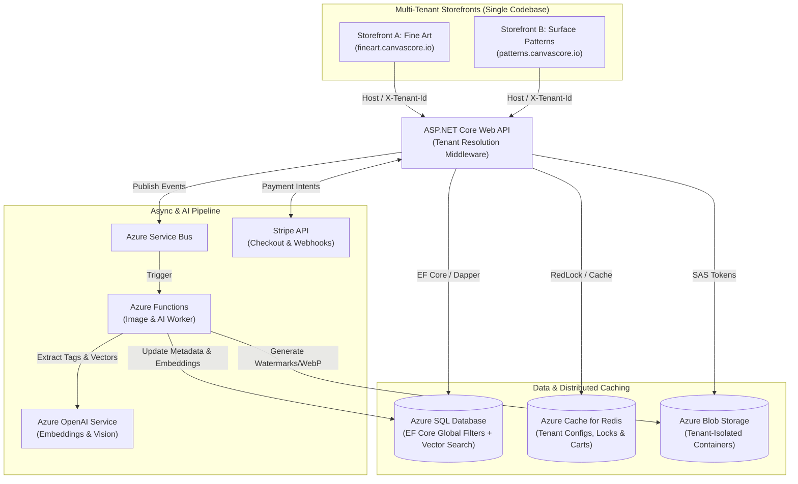

# CanvasCore — Multi-Tenant Cloud Art Marketplace & Print-on-Demand Engine

[](https://microsoft.com)
[](https://react.dev)
[](https://microsoft.com)
[](https://opensource.org)

**CanvasCore** is a multi-tenant, event-driven e-commerce and digital asset management engine built to power multiple niche art storefronts from a single shared codebase. Designed for independent artists and curated galleries, it supports selling one-of-a-kind original pieces, made-to-order physical prints, and downloadable surface patterns across distinct branded domains.

Built with **Clean Architecture** and **Domain-Driven Design (DDD)** principles, this repository serves as a reference implementation for SaaS multi-tenancy, high-concurrency inventory locking, asynchronous media processing, and AI-powered semantic discovery on **Microsoft Azure**.

---

## 🏗️ System Architecture

The platform decouples a theme-driven **React (TypeScript)** Single Page Application from a multi-tenant **ASP.NET Core Web API**, leveraging Azure PaaS services for asynchronous background processing, distributed locking, and vector search.



---

## 🚀 Key Enterprise & Architectural Features

### 1. Multi-Tenant White-Label Storefront Engine
* **The Challenge:** Scaling across multiple art verticals (e.g., fine art paintings vs. commercial surface patterns) without maintaining duplicate repositories or deployments.
* **The Solution:** 
  * **Backend Tenant Resolution:** Custom ASP.NET Core middleware resolves the active tenant from the incoming request host or `X-Tenant-Id` header, caching tenant configurations in **Azure Cache for Redis**.
  * **Automated Data Isolation:** Uses **EF Core Global Query Filters** on `TenantId` across all domain entities to guarantee strict data isolation between storefronts at the ORM level.
  * **Dynamic Frontend Theming:** A single **React + TypeScript** SPA fetches `/api/storefront/config` on initialization to dynamically inject CSS custom properties (brand colors, typography), logos, and navigation rules.

### 2. High-Concurrency Inventory Locking (Originals vs. Prints)
* **The Challenge:** Original paintings have a strict inventory of `1`, whereas prints and digital patterns have on-demand availability. Two buyers must never be able to purchase the same original piece simultaneously.
* **The Solution:** Implemented **Distributed Locking via Azure Cache for Redis** paired with **EF Core Optimistic Concurrency (`RowVersion`)** in Azure SQL. Initiating checkout on an original work acquires a 10-minute distributed reservation lock before handing off to Stripe.

### 3. Event-Driven Media & Watermarking Pipeline
* **The Challenge:** Uploading raw, high-resolution master artwork files (50MB+ TIFF/PNG) synchronously blocks API threads and slows down storefront rendering.
* **The Solution:** Artists upload master files directly to tenant-scoped **Azure Blob Storage** containers using short-lived **Shared Access Signature (SAS) tokens**. Upload events publish a message to **Azure Service Bus**, triggering an isolated **Azure Function** that generates optimized WebP thumbnails, applies dynamic watermarks to public previews, and promotes assets to a CDN-backed public container.

### 4. AI-Powered Art Discovery & Visual Search
* **Tenant-Scoped Semantic Search:** Uses **Azure OpenAI (`text-embedding-3-small`)** and native **Azure SQL Vector Search (`VECTOR` data type)** combined with tenant filters so buyers can search naturally (e.g., *"moody coastal landscape with muted blues for a minimalist living room"*).
* **Automated Metadata & Alt-Text Generation:** Upon upload, **Azure OpenAI Vision (GPT-4o)** analyzes the artwork to suggest color palettes, artistic styles, medium tags, and WCAG-compliant accessibility alt-text.

### 5. Idempotent Payment & Fulfillment Orchestration
* **Stripe Webhooks:** Processes asynchronous `checkout.session.completed` events using a transactional **Inbox/Idempotency Table** in SQL Server to ensure duplicate webhook deliveries never trigger double-fulfillment.

---

## 🛠️ Technology Stack

| Layer | Technologies |
| :--- | :--- |
| **Frontend** | React 19, TypeScript, Vite, Tailwind CSS, TanStack Query, Zustand |
| **Backend API** | C# / .NET 9, ASP.NET Core Web API, MediatR (CQRS), FluentValidation |
| **Database & Cache** | Azure SQL Server (EF Core 9 + Native Vector Type), Azure Cache for Redis |
| **AI & Messaging** | Azure OpenAI (Embeddings + Vision), Azure Service Bus, Azure Functions |
| **Storage & Security** | Azure Blob Storage (SAS Tokens), Microsoft Entra External ID (Multi-Tenant Auth) |
| **DevOps & Testing** | Docker Compose, GitHub Actions CI/CD, xUnit, Testcontainers, Terraform |

---

## 📂 Clean Architecture Solution Structure

```text
CanvasCore/
├── src/
│   ├── CanvasCore.Domain/            # Multi-tenant entities, value objects, domain events (Zero dependencies)
│   ├── CanvasCore.Application/       # CQRS commands/queries, MediatR handlers, ITenantContext, DTOs
│   ├── CanvasCore.Infrastructure/    # EF Core DbContext (Global Query Filters), Azure Blob/OpenAI/Redis
│   ├── CanvasCore.Api/               # REST Controllers, TenantResolutionMiddleware, OpenAPI/Swagger
│   ├── CanvasCore.Worker/            # Azure Functions for async image processing & AI vectorization
│   └── canvascore-client/            # Multi-theme React + TypeScript SPA (.esproj)
├── tests/
│   ├── CanvasCore.UnitTests/         # Domain invariants, tenant isolation & handler unit tests
│   └── CanvasCore.IntegrationTests/  # End-to-end API tests using Testcontainers (SQL Server & Redis)
├── docs/
│   └── adr/                          # Architecture Decision Records (ADRs)
├── infra/                            # Terraform / Bicep IaC templates for Azure deployment
└── docker-compose.yml                # One-command local environment (SQL Server, Redis, Azurite)
```

---

## 📑 Architecture Decision Records (ADRs)

Key architectural trade-offs and SaaS design choices are documented in `/docs/adr`:
* [ADR-001: Shared Database with Discriminator Column (`TenantId`) vs. Database-per-Tenant](docs/adr/001-multi-tenancy-strategy.md)
* [ADR-002: Choosing Azure SQL Vector Search over a Dedicated Vector Database](docs/adr/002-sql-vector-search.md)
* [ADR-003: Distributed Locking Strategy for One-of-a-Kind Inventory](docs/adr/003-redis-inventory-locking.md)
* [ADR-004: Direct-to-Blob Uploads via SAS Tokens vs. API Proxying](docs/adr/004-sas-token-uploads.md)
* [ADR-005: Ensuring Idempotency in Stripe Payment Webhooks](docs/adr/005-stripe-webhook-idempotency.md)

---

## 💻 Local Development Setup

Run the entire multi-tenant stack locally using Docker for SQL Server, Redis, and Azure Storage emulation (Azurite).

### Prerequisites
* [.NET 9 SDK](https://microsoft.comdownload)
* [Node.js 20+](https://nodejs.org)
* [Docker Desktop](https://docker.com)
* An Azure OpenAI API key (or toggle `UseMockAiServices: true` in `appsettings.Development.json`)

### Quick Start

1. **Clone the repository**
   ```bash
   git clone https://github.com
   cd canvascore
   ```

2. **Spin up local infrastructure (SQL Server, Redis, Azurite)**
   ```bash
   docker-compose up -d
   ```

3. **Apply Entity Framework Core migrations**
   ```bash
   dotnet ef database update --project src/CanvasCore.Infrastructure --startup-project src/CanvasCore.Api
   ```

4. **Configure user secrets**
   ```bash
   cd src/CanvasCore.Api
   dotnet user-secrets set "AzureOpenAI:ApiKey" "your-key-here"
   dotnet user-secrets set "Stripe:SecretKey" "sk_test_your-key-here"
   ```

5. **Run the Solution**
   * Open `CanvasCore.slnx` in **Visual Studio 2022** and press **F5** (configured with multiple startup projects for `CanvasCore.Api`, `CanvasCore.Worker`, and `canvascore-client`), **OR** run via CLI:
   ```bash
   dotnet run --project src/CanvasCore.Api
   ```
